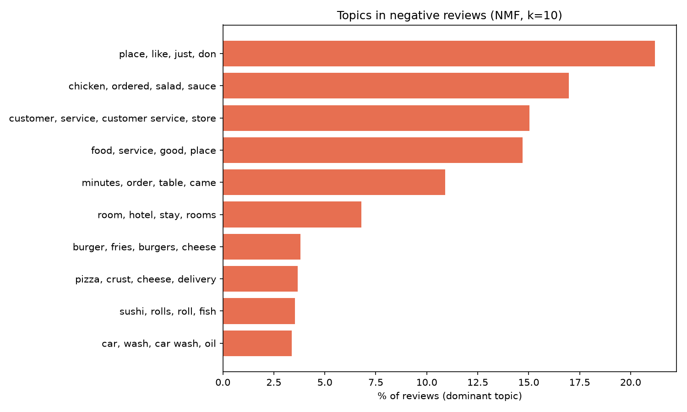
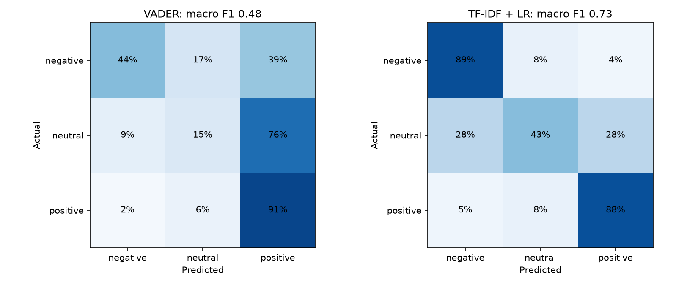
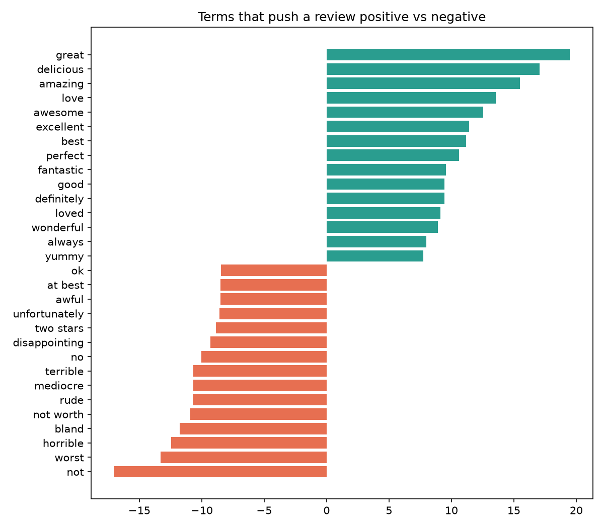
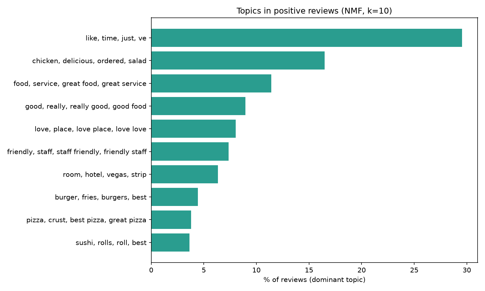
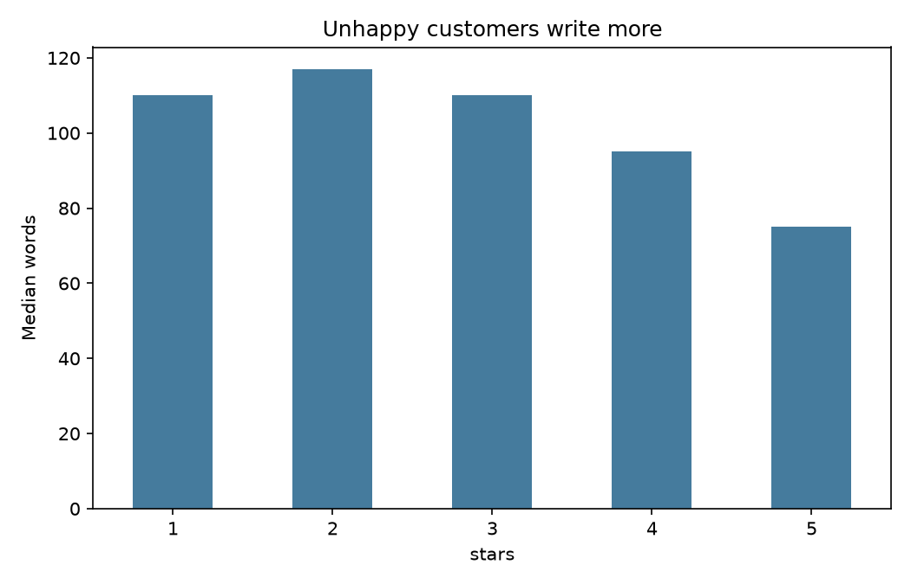

# Review sentiment and topic modelling: what makes customers happy or angry

An NLP pipeline on **50,000 real Yelp reviews** (mostly restaurants, plus hotels, shops and services). It compares a lexicon baseline
with a trained classifier, predicts star ratings, finds the main complaint and praise themes with NMF topic modelling,
and writes **LLM-free extractive summaries** of each theme (a TextRank-style method).

Author: Anthony Adusei-Poku ([@anthony07-max](https://github.com/anthony07-max))



## Key findings
1. **A trained model beats an off-the-shelf lexicon.** On 9,989 held-out reviews, TF-IDF + logistic regression scores 79.1% accuracy
   (macro F1 0.73) across negative, neutral and positive. VADER manages 57.0% (F1 0.48). VADER struggles with mixed 3-star reviews and sarcasm.
2. **Star ratings are predictable within one star.** The exact-star accuracy is 58.4%, but 93.8% of predictions are within one star (MAE 0.56
   using expected stars). Most errors are between neighbouring ratings such as 4 and 5, which people use inconsistently.
3. **Complaints are mainly about service and time, not just food.** Among negative reviews, 15% are mainly about **customer service**
   (rude staff, managers, phone calls) and 11% about **waiting** (minutes, table, order, server). Another 15% are about overall food and service quality.
   The **chicken, sauce and salad** dish-quality theme alone covers 17%.
4. **Praise is about people.** In positive reviews, "friendly staff", "clean" and "recommend" form their own theme (7%), and the strongest
   negative terms after "not" and "worst" include **"bland"**, **"rude"** and **"mediocre"**.
5. **Unhappy customers write more.** The median length is 110 to 117 words for 1 and 2-star reviews against 75 for 5-star reviews.

| | |
|---|---|
|  |  |
|  |  |

**Example auto-summaries** (the most central sentences of each topic, chosen without an LLM):
- *Waiting:* "We then waited another 10 minutes for our server to come back around to order more drinks and food."
- *Customer service:* "customer service, not service at all."
- *Friendly staff (positive):* "Always friendly staff and consistently great food."

## Method
- **Sentiment:** 1-2 stars are negative, 3 is neutral, 4-5 is positive. An 80/20 split is stratified by star rating. The model is TF-IDF on words and bigrams (sublinear tf) with multinomial logistic regression. The
  baseline is the VADER compound score with fixed thresholds.
- **Topics:** NMF (k=10) on TF-IDF fitted separately to negative and positive reviews. Topics are labelled by their top terms.
- **Summaries:** sentences from the 400 reviews most strongly linked to each topic are ranked by PageRank on a TF-IDF cosine-similarity graph,
  with near-duplicates removed (`src/summarise.py`). The Streamlit app lets you paste your own reviews to summarise.
- **Limitations:** this is the Yelp benchmark sample, which is star-balanced (about 10k per star), so the class mix isn't representative. It has no business IDs or dates, so it can't
  track change over time. Generic topics such as "place, like, just" soak up conversational reviews.

## Data source
- [Yelp Review Full](https://huggingface.co/datasets/Yelp/yelp_review_full) (test split, 50,000 reviews), from the
  [Yelp Open Dataset](https://www.yelp.com/dataset) as packaged by Zhang et al. (2015). It's used here for non-commercial, educational analysis
  under the Yelp dataset terms. No reviews are redistributed in this repo, and the pipeline downloads them.
- [VADER sentiment](https://github.com/cjhutto/vaderSentiment) (Hutto and Gilbert, 2014).

## How to run
```bash
python -m venv .venv && source .venv/bin/activate
pip install -r requirements.txt
bash run_pipeline.sh            # about 2 to 3 minutes
streamlit run app/streamlit_app.py
```
